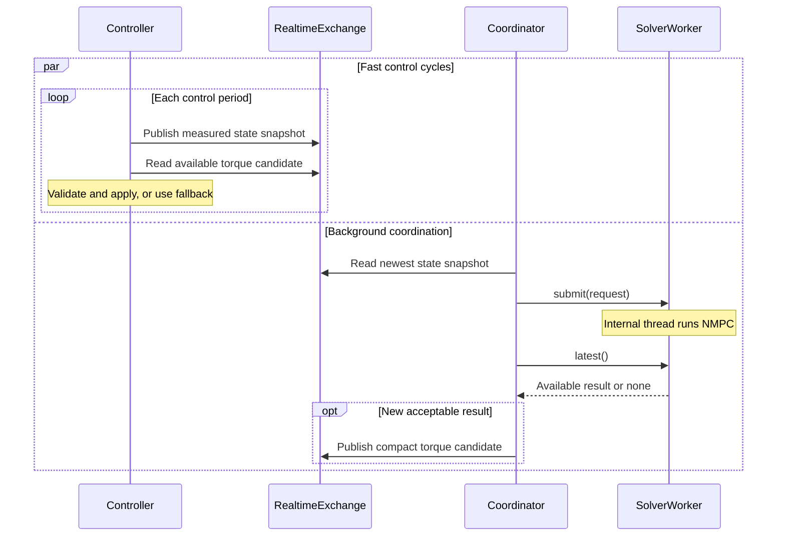

# NMPC Coordinator: Connecting Control and Optimization

Think of a restaurant: the **controller** serves the robot on a fixed schedule, the **solver** prepares the next optimal torque, and the **coordinator** manages requests and results. The controller must keep working while the solver is busy.

**The coordinator is a non-real-time bridge between the fast control loop and the background NMPC worker.** It prepares optimization requests and returns available results through a real-time data exchange.

## Implementation Status

This document describes the proposed integration architecture. When this document was expanded, `nmpc_coordinator.hpp`, `nmpc_coordinator.cpp`, and `realtime_exchange.hpp` were not available at their expected paths on `main`. Their responsibilities below are design requirements.

The existing [SolverWorker API](../include/fr3_nmpc_controller/solver_worker.hpp) provides `submit()`, `latest()`, reference cancellation, and a background solver thread.

## Responsibilities

| Component | Responsibility |
| --- | --- |
| Controller thread | Read measured state, publish a snapshot, validate available torque candidates, perform the required torque conversion and limiting, and write actuator commands or use fallback control. |
| RealtimeExchange | Provide bounded, real-time-compatible transfer of state snapshots and compact torque candidates. |
| Coordinator thread | Read fresh state snapshots, prepare reference horizons, submit requests, and forward new available results. |
| SolverWorker | Schedule background solves, retain the newest accepted pending request, and reject invalid or expired results. |
| Optimizer | Solve the NMPC problem and compute modeled total joint torque. |

The coordinator handles communication and scheduling. The optimizer computes the control action; the controller owns the final actuator decision.

## Figure 1 — Control and Optimization Run Concurrently

The following sequence shows the proposed data exchange. `latest()` returns an available result or no result; it does not wait for IPOPT to finish.

`RealtimeExchange` is shared communication infrastructure, not an additional thread.

With two single-producer, single-consumer (SPSC) queues, ownership is:

| Queue | Producer | Consumer |
| --- | --- | --- |
| Robot state snapshots | Controller thread | Coordinator thread |
| Torque candidates | Coordinator thread | Controller thread |

Reference callbacks need their own synchronized handoff to the coordinator. They must not become an additional producer on an SPSC queue.

## What the Coordinator Does

1. **Read the newest available state.** Use its original measurement timestamp; avoid building a backlog of obsolete states.
2. **Build a solver request.** Combine the state with the reference horizon, previous total torque, and reference ID.
3. **Submit the request.** Call `SolverWorker::submit()` from the non-real-time coordinator thread.
4. **Retrieve an available result.** Call `latest()` and identify whether the result is new.
5. **Publish a compact torque candidate.** Preserve the result's source timestamp, expiry, reference ID, and request ID for controller-side validation.

The coordinator should forward only the fixed-size information needed by the controller. Full predicted trajectories and diagnostic vectors should stay outside the real-time exchange.

### Preparing the Reference Horizon

The existing `SolverRequest` expects `N + 1` reference states aligned to the source state time:

$$
x_{\mathrm{ref}}(t_s),\quad
x_{\mathrm{ref}}(t_s + \Delta t),\quad \ldots,\quad
x_{\mathrm{ref}}(t_s + N\Delta t)
$$

Here, `N` and `dt` come from the optimizer configuration. The request's `previous_total_torque` must use the optimizer's modeled total-torque convention, with a clearly defined relationship to the torque actually applied after conversion and limiting.

The worker assigns `request_id`; the coordinator must not assume that a caller-supplied ID will be retained.

## Why a Separate Coordinator Thread?

The worker already runs IPOPT in a background thread, but its public interface still uses mutexes and dynamic copies:

- `submit()` accepts a request containing a dynamic reference vector.
- `latest()` copies a result that can contain dynamic prediction vectors.
- Both functions acquire a mutex.

The worker header explicitly restricts these calls to non-real-time code. A coordinator moves those interactions outside `controller.update()`.

A separate coordinator is an architectural choice for this worker interface. NMPC itself does not mathematically require a coordinator thread; a different worker with a suitable real-time interface could use another arrangement.

## Issues and Corresponding Solutions

| Issue | Corresponding solution |
| --- | --- |
| IPOPT takes longer than a control period. | Run optimization in the worker while the controller continues its cycles. |
| Worker API calls can lock or allocate. | Call them from the coordinator and use a bounded exchange at the control boundary. |
| States arrive faster than the solver can process them. | Prefer fresh snapshots and preserve the worker's newest-pending-request behavior. |
| A result arrives after a reference changes. | Preserve reference IDs, invalidate obsolete results through serialized non-real-time ownership, and reject mismatched candidates in the controller. |
| A successful result is already too old. | Preserve its original expiry and check it again immediately before use. |
| Repeated polling returns the same result. | Track the last forwarded request ID; never refresh the result's timestamp or expiry. |
| No acceptable result is available. | Use the controller's defined fallback behavior. |

The existing worker already rejects expired results and invalidates results from canceled or replaced references. Controller-side checks remain necessary because a candidate can expire after it leaves the worker.

## Timing Example

Suppose the controller period is **1 ms** and one solve takes **20 ms**. These are illustrative values.

The controller continues running during the solve. It may use a previously accepted command only within the allowed validity window and control policy; otherwise it must use fallback control.

Freshness is measured from the **source robot state**, including time spent waiting, solving, and transferring the result:

$$
T_{\mathrm{age}} = t_{\mathrm{now}} - t_{\mathrm{source\ state}}
$$

In the existing worker:

$$
t_{\mathrm{expiry}} =
t_{\mathrm{source\ state}} + T_{\mathrm{max\ age}}
$$

Forwarding a result must not extend that expiry. Thread separation protects the control loop from solver execution time, but does not by itself guarantee control stability or hard real-time behavior.

## Lifecycle and Ownership

Serialize worker start, cancellation, and stop operations through a defined non-real-time owner. Stop and join threads outside the real-time update callback.

The existing `SolverWorker::stop()` waits for an active solve to return. It cannot preempt IPOPT and has no hard shutdown deadline.

## Related Source Files

- [solver_worker.hpp](../include/fr3_nmpc_controller/solver_worker.hpp): request fields, threading contract, and public API.
- [solver_worker.cpp](../src/solver_worker.cpp): scheduling, reference invalidation, and source-state expiry checks.
- [optimizer.hpp](../include/fr3_nmpc_controller/optimizer.hpp): total-torque result, reference horizon, and optimizer configuration.
