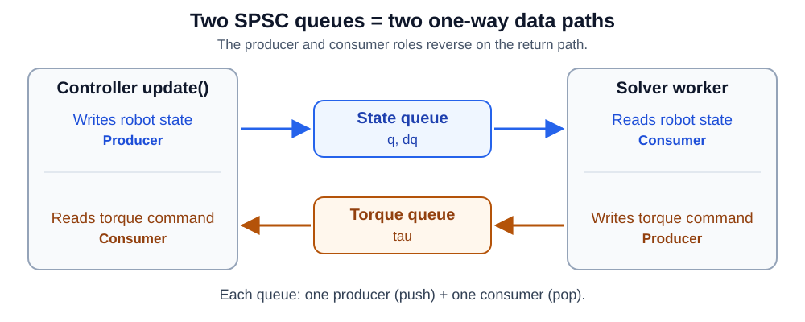

# Key Questions Before Integration

Before you start integrating the components, you should be able to answer these three questions.

## Q1: Why can't IPOPT be called directly inside `controller.update()`?

The solver may take longer than the control period, causing the control thread to miss its deadline.

## Q2: Why are two SPSC queues needed?

Robot states and torque commands travel in opposite directions. Each direction has its own producer and consumer, so this SPSC design uses a separate single-producer, single-consumer queue for each direction.

Think of them as **two one-way mailboxes**: one sends robot states to the solver; the other returns torque commands to the controller.

*Figure: The same two threads exchange different data in opposite directions. Here, q and dq are joint positions and velocities, and tau is the joint torque command.*

**Why not use one shared SPSC queue?** Both threads would write to and read from that queue, giving it two producers and two consumers. That breaks the SPSC contract. With two queues, each queue keeps exactly one writer and one reader.

## Q3: Why can't the controller simply execute every `TorqueCommand` in the queue?

An old command may have been computed from a past robot state. Before applying a solver result, the controller needs to check:

- Its timestamp.
- Its reference version.
- Its validity.
- Whether the torque satisfies the limits.

## Your Next Task

Run `test_realtime_exchange` first to verify that the data exchange module works correctly.

## Next Lesson

**Lesson 8 — Integrate RealtimeExchange into Fr3NmpcController**

After the test passes, the next lesson will cover these changes:

| Component | Changes |
| --- | --- |
| `controller.hpp` | Declare the exchange module and thread state. |
| `controller.cpp` | Implement state publishing, thread coordination, and result retrieval and validation. |
| `SolverWorker` | Keep its existing responsibility for background optimization. |
