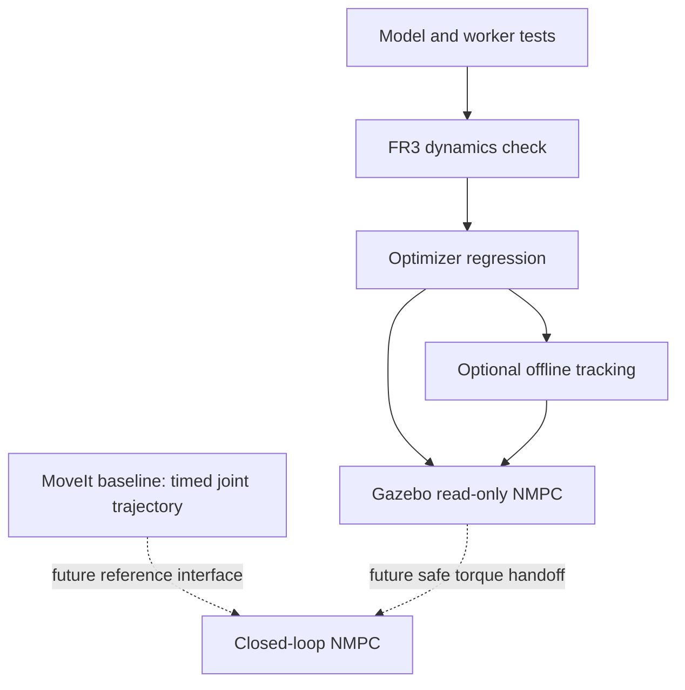
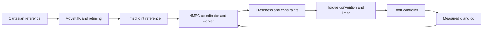

# FR3 NMPC — Step-by-step Testing Guide

Ubuntu 24.04 · ROS 2 Jazzy · Franka FR3 · Gazebo · Pinocchio · CasADi/IPOPT

## 1. What are we testing?

Follow the stages in order. Stop at the first failed stage.

| Stage | Test | Robot motion? | Current support |
| --- | --- | --- | --- |
| A | Build, model and worker unit tests | No | main |
| B | Offline FR3 dynamics consistency | No | main |
| C | CasADi/IPOPT optimizer regression | No | main, CasADi ON |
| D | Offline hold/move tracking and CSV | No | Local development executable, if present |
| E | Gazebo state ingestion and read-only NMPC | No NMPC commands | main, CasADi ON |
| F | MoveIt linear/arc baseline execution | Yes, simulation only | Local MoveIt integration, not main NMPC |
| G | Closed-loop NMPC tracking | Not yet supported | Future integration |



**Safety boundary:** Disconnect the physical FR3 for these tests. Use ROS_DOMAIN_ID=10 for simulation and stop any bridge to the real-robot domain. The NMPC controller plugin deliberately refuses activation on main. Do not remove this guard, activate its effort interface, or replace a working arm controller to test the solver. Read-only diagnostic torques are never sent to the robot.

## 2. Environment (every terminal)

```bash
source /opt/ros/jazzy/setup.bash
source ~/franka_ros2_ws_jazzy/install/setup.bash
export ROS_DOMAIN_ID=10
cd ~/panda_franka_robot
# Source the overlay when it exists:
source install/setup.bash
```

For a first build, skip the last source command until the workspace is built. Check your branch and local changes before fetching any code:

```bash
git branch --show-current
git status --short
```

Do not overwrite the local NMPC package, custom CasADi settings or MoveIt model fixes with main. This guide adds documentation only.

## 3. Stage A — Build and unit tests (Terminal 1, no Gazebo)

Dependencies: ROS 2 Jazzy, Eigen3, Pinocchio, C++17, ament_cmake_gtest. For the optimizer, a compatible C++ CasADi installation with IPOPT is required. See [README](../README.md#dependencies-and-build).

```bash
cd ~/panda_franka_robot
colcon build --packages-select fr3_nmpc_controller --symlink-install \
  --cmake-args -DBUILD_TESTING=ON -DFR3_NMPC_WITH_CASADI=OFF
source install/setup.bash
colcon test --packages-select fr3_nmpc_controller --event-handlers console_direct+
colcon test-result --test-result-base build/fr3_nmpc_controller --verbose
```

| Test | What it checks |
| --- | --- |
| test_robot_model | Model load, gravity equilibrium, invalid inputs |
| test_solver_worker | Background scheduling, expiry, lifecycle, exceptions |
| test_unimplemented_backends | Uninitialized components cannot produce commands |
| test_torque_adapter | Finite total-torque to effort conversion |
| test_optimizer | Only built with CasADi ON; solve, constraints and warm start |

Pass: build succeeds and all available tests report zero failures and errors. CasADi OFF does **not** test the NMPC optimizer.

## 4. Stage B — Numerical FR3 dynamics check (Terminal 1)

Use your expanded seven-joint arm-only FR3 URDF with verified inertias and limits. The path below was used in local development; it is not guaranteed to exist after reboot. Do not use the synthetic unit-test fixture as a physical FR3 model.

```bash
ls -lh /tmp/fr3_arm_only.urdf
ros2 run fr3_nmpc_controller check_model /tmp/fr3_arm_only.urdf
echo "check_model exit status: $?"
```

If the file is missing, regenerate/export the verified seven-joint FR3 URDF using your installed Franka description before continuing. Do not substitute an arbitrary Panda URDF.

Expected output:

```text
max |qdd(q,0,g(q))| = ... rad/s^2
gravity-hold integration drift = ... rad
inverse/forward acceleration error = ... rad/s^2
Numerical consistency only; not an FR3 hardware validation.
```

Pass: all three errors are below 1e-8 and exit code is 0 (as implemented in [check_model.cpp](../examples/check_model.cpp)). This verifies internal dynamics consistency, not physical accuracy.

## 5. Stage C — Enable NMPC optimizer (Terminal 1)

```bash
colcon build --packages-select fr3_nmpc_controller --symlink-install \
  --cmake-args -DBUILD_TESTING=ON -DFR3_NMPC_WITH_CASADI=ON
source install/setup.bash
ros2 pkg executables fr3_nmpc_controller
colcon test --packages-select fr3_nmpc_controller --event-handlers console_direct+
colcon test-result --test-result-base build/fr3_nmpc_controller --verbose
```

If CMake cannot find CasADi, reuse the verified local CMake directory with -Dcasadi_DIR=/your/actual/casadi/cmake. If Pinocchio is missing, check the installed pinocchio_DIR. Do not force an incompatible C++ ABI. A Python CasADi import is not proof of a compatible C++ solver.

Expected executables on main: check_model and gazebo_nmpc_diagnostic. The optimizer test must be built and pass with CasADi ON. A successful solve does not establish a hard real-time deadline.

## 6. Stage D — Optional local offline tracking experiments

The development machine previously used offline_tracking (hold/move) and CSV logs. **This executable is not defined in the inspected main CMakeLists.txt.** Do not assume a fresh clone has it.

```bash
ros2 pkg executables fr3_nmpc_controller
find src/fr3_nmpc_controller -iname '*offline*'
grep -n 'offline_tracking' src/fr3_nmpc_controller/CMakeLists.txt
```

If your local executable exists, inspect its actual command-line interface in its source before running hold and move; use --help only if that version implements it. Preserve the local solver configuration. If absent, skip this optional stage.

Previously used output paths: /tmp/fr3_nmpc_hold.csv and /tmp/fr3_nmpc_move.csv. Check the files and their headers before analysis:

```bash
ls -lh /tmp/fr3_nmpc_*.csv
head -n 3 /tmp/fr3_nmpc_move.csv
```

Record solve success, joint tracking RMSE, maximum constraint violation, mean/max solve time and fraction exceeding the configured solver period. Keep controller update period and optimizer prediction step separate. These offline results do not establish Gazebo or hardware tracking.

## 7. Stage E — Gazebo read-only NMPC (two terminals)

### Terminal 1 — Simulation

After the CasADi-enabled build, start a fresh simulation if not already running:

```bash
ros2 launch fr3_sim_bringup fr3_gazebo.launch.py
```

Keep running. Main bringup only starts the joint state broadcaster; it does not activate an arm motion/hold controller. Use a separately verified stable simulation controller before evaluating NMPC. Without one, the arm may sag. Do not activate the NMPC plugin.

### Terminal 2 — Verify feedback and run solver diagnostic

Apply the environment setup from section 2 in this terminal.

```bash
ros2 control list_controllers
ros2 topic info /joint_states -v
ros2 topic echo /joint_states --once
ros2 topic hz /joint_states
```

Stop hz with Ctrl+C. Check all seven FR3 joint names, finite positions/velocities, fresh timestamps, and a stable robot pose.

```bash
test -s /tmp/fr3_arm_only.urdf
ros2 run fr3_nmpc_controller gazebo_nmpc_diagnostic --ros-args \
  -p model_urdf_path:=/tmp/fr3_arm_only.urdf \
  2>&1 | tee /tmp/fr3_nmpc_gazebo_readonly.log
```

Only run if the model file exists and matches the simulated arm, including gravity, joint order, limits, payload and inertia. Expected log:

```text
NMPC read-only: solve=... ms violation=... max_hold_error=... rad candidate_tau1=... Nm (NOT applied)
```

The diagnostic captures a stationary hold reference and samples at 4 Hz. It does not subscribe to the Cartesian reference topic, track a line/arc, or apply torque. Its previous torque seed is model gravity, not measured command history.

Pass: valid samples produce finite successful candidate results; review constraint violation and latency against the configured acceptance criteria. If repeated errors or expiry occur, inspect the model and timing rather than bypassing checks.

See [Gazebo read-only guide](../GAZEBO_READONLY_GUIDE.md) and [torque adapter guide](../TORQUE_ADAPTER_GUIDE.md).

## 8. Stage F — Optional MoveIt baseline motion (local development only)

Purpose: establish a reference motion benchmark before integrating NMPC. This is a **position-controller experiment**, not NMPC. Stop the read-only diagnostic if comparing independent runs. The following local files were used during development but are not all available on main; verify their existence and your local model configuration before using these commands.

Every terminal uses section 2. Do not start a second Gazebo or MoveIt process if one is already running.

| Terminal | Module |
| --- | --- |
| 1 | Gazebo |
| 2 | Position JointTrajectoryController |
| 3 | MoveIt |
| 4 | Reference Generator |
| 5 | Reference Tracker |

Terminal 1:

```bash
ros2 launch fr3_sim_bringup fr3_gazebo.launch.py
```

Terminal 2:

```bash
ros2 control list_controllers
ros2 control list_hardware_interfaces
```

Only if the seven FR3 position interfaces are available, the local controller YAML exists and no competing arm controller is active, load an absent controller:

```bash
test -f src/panda_moveit/config/execution/fr3_gazebo_controllers.yaml
ros2 param set /controller_manager fr3_arm_controller.type \
  joint_trajectory_controller/JointTrajectoryController
ros2 run controller_manager spawner fr3_arm_controller \
  -c /controller_manager \
  -p "$PWD/src/panda_moveit/config/execution/fr3_gazebo_controllers.yaml" --inactive
```

For a loaded inactive controller, activate only in the isolated simulation:

```bash
ros2 control set_controller_state fr3_arm_controller active
ros2 control list_controllers
```

Terminal 3 (requires the local simulation-only launch and consistent URDF/SRDF, TCP, kinematics and joint-limit configuration):

```bash
ros2 launch panda_moveit fr3_moveit_gazebo.launch.py
```

In Terminal 2 verify:

```bash
ros2 param get /move_group allow_trajectory_execution
ros2 action info /fr3_arm_controller/follow_joint_trajectory
```

Execution requires True, an active arm controller and a matching action server. Do not use the real FR3 IP-address launch.

Terminal 4 — generate the tested linear reference:

```bash
ros2 run panda_reference_trajectories reference_generator --ros-args \
  -p frame_id:=fr3_link0 \
  -p path_topic:=/fr3_reference/cartesian_path \
  -p path_type:=linear \
  -p orientation_x:=-0.032 -p orientation_y:=0.01 \
  -p orientation_z:=-0.030 -p orientation_w:=0.998 \
  -p start_x:=0.334 -p start_y:=-0.15 -p start_z:=0.25 \
  -p goal_x:=0.334 -p goal_y:=0.044 -p goal_z:=0.25 \
  -p step_size:=0.005
```

Expected: 40 waypoints. Keep the generator running. For arc experiments inspect the local generator's declared parameters and preview reachability first.

Terminal 5 — inspect the installed launch interface:

```bash
ros2 launch panda_moveit reference_tracking.launch.py --show-args
```

Main is planning-only and has no execute argument. On the local execution-enabled revision, preview:

```bash
ros2 launch panda_moveit reference_tracking.launch.py \
  profile:=fr3_gazebo application:=baseline execute:=false
```

Only after validation passes and the physical robot is disconnected, run the locally compiled execution-enabled tracker:

```bash
ros2 launch panda_moveit reference_tracking.launch.py \
  profile:=fr3_gazebo application:=baseline execute:=true \
  cost_csv_path:=/tmp/fr3_baseline_execution.csv \
  2>&1 | tee /tmp/fr3_execution_latest.log
```

Expected sequence: plan and validate approach; execute approach; obtain fresh measured state and verify TCP at reference start; replan and validate Cartesian process; execute process. The sequential V3 repair was proposed locally but has not been verified on main or in a new successful execution. Do not interpret this expected sequence as test evidence.

Latest known local failure: approach executed, but Cartesian initial joint position differed from measured state by approximately 0.081 rad (J1) and 0.110 rad (J3). Replan from the measured approach endpoint if valid, rather than disabling start-state or collision validation.

```bash
grep -E 'START CHECK|APPROACH END|APPROACH TCP|Replanning|segment|ERROR' \
  /tmp/fr3_execution_latest.log
```

Success requires both segments to execute successfully and actual joint/TCP motion to follow the reference. 100% Cartesian planning alone is not a tracking result. The current custom MoveIt costs are scoring-only; selecting surfacing does not demonstrate active optimization.

## 9. Stage G — Future closed-loop NMPC integration (not a runnable test)



A geometric nav_msgs/Path does not contain the timed joint-state horizon required by the NMPC optimizer. Before attempting motion, implement reference timing/handoff, safe real-time exchange, result validity checks, verified torque/gravity conversion, actual command history, limits/rate limits, fallback behavior and explicit completion handling. See [Coordinator](Coordinator.md).

Maintain one arm-command owner. Compare position baseline and NMPC on identical reference timing, initial state, payload and environment. Do not run the position and effort controllers concurrently on the same arm. No activation or torque-publishing command is provided because the current controller is not ready.

## 10. Troubleshooting and test record

| Symptom | First check |
| --- | --- |
| CasADi target not found | CMake option, compatible casadi_DIR and IPOPT |
| gazebo_nmpc_diagnostic not found | CasADi ON, rebuild, source correct overlay |
| Controller manager unavailable | Gazebo process, domain, ros2 service list |
| Arm controller inactive | Controller loading/configuration; do not activate NMPC |
| No fresh joint state | /joint_states publishers, timestamps and /clock |
| Goal rejected | Controller active state, joint mapping, controller logs |
| Start mismatch | Actual vs planned state; replan, preserve validation |
| Read-only candidate expires | Solver latency, source timestamp and configured max age |
| No robot movement in diagnostic | Expected; candidate torque is not applied |

For each run record branch/commit, model identity, configuration, test command, initial pose, reference, log/CSV path, pass/fail, and next action.

```bash
git rev-parse --short HEAD
ros2 pkg prefix fr3_nmpc_controller
ros2 pkg prefix panda_moveit
```

For future executed tracking comparisons, measure actual time-aligned joint RMSE, TCP position/orientation error, completion time, torque/rate limits, solver latency and constraint violations. Planned scores are not measured tracking errors.

**Validation status:** This guide was assembled from the main source/CMake and existing guides plus the local MoveIt troubleshooting history. Commands were reviewed against those sources, not executed on the target Ubuntu/Gazebo machine. No source or controller configuration is changed by this documentation commit.
