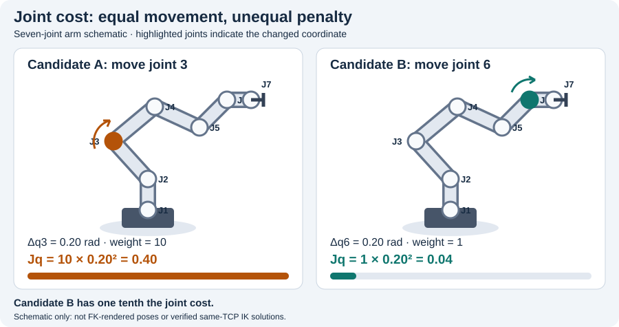
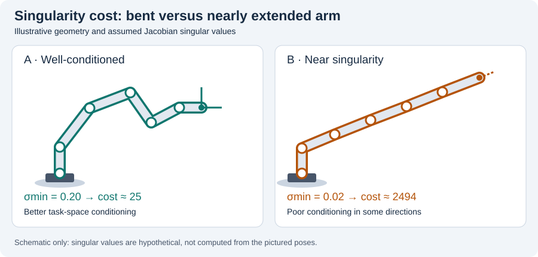
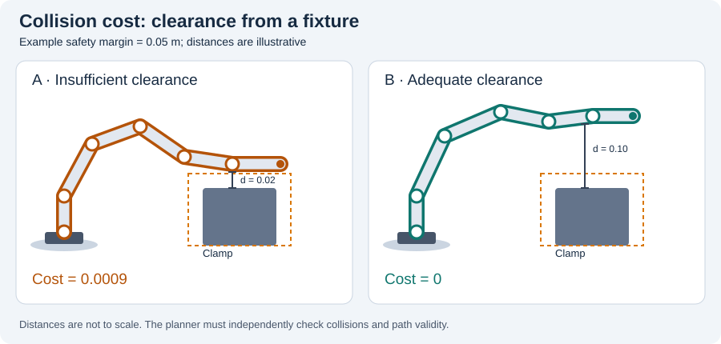
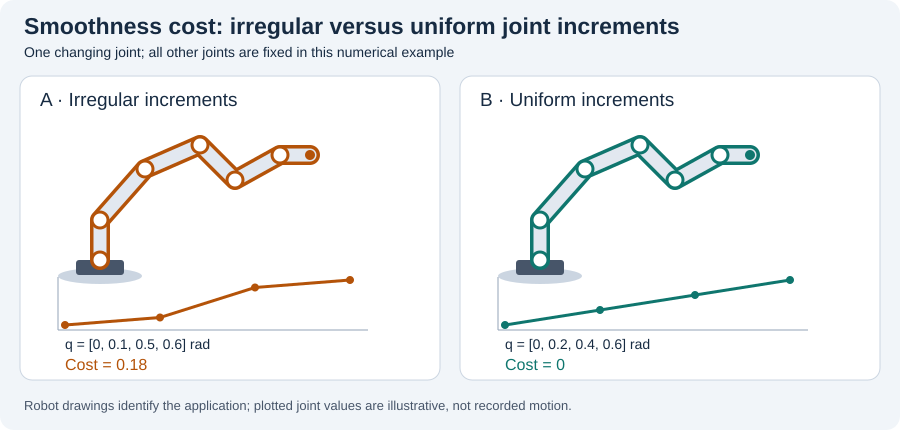
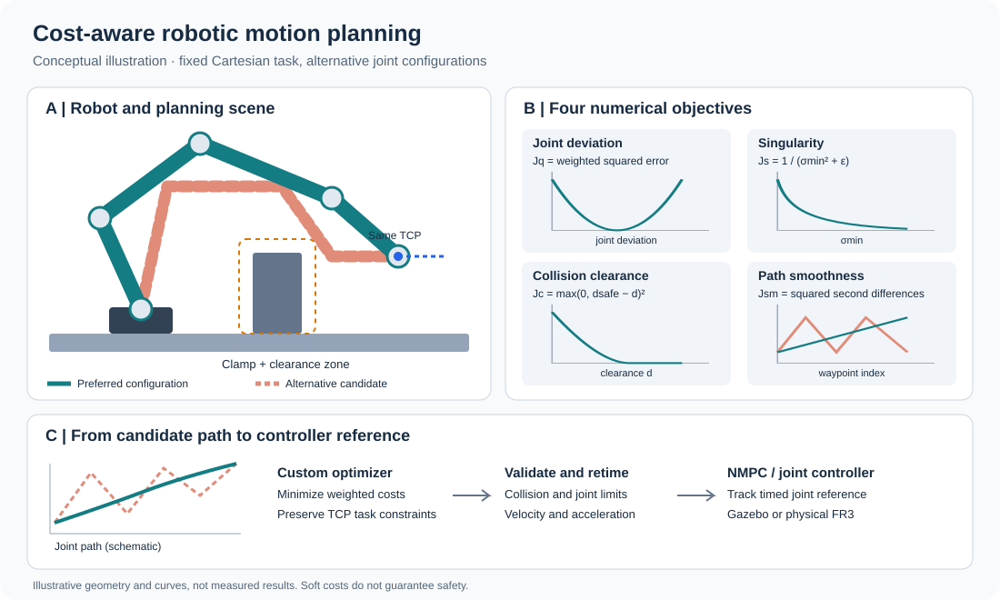

# Customized Cost Functions

This module evaluates the quality of candidate joint configurations and trajectories for Panda/FR3 motion planning. MoveIt supplies robot kinematics, planning-scene geometry and state validity infrastructure; these C++ functions supply numerical objectives to a custom optimizer.

## 1. Module structure

| Source file | Function | Application |
| --- | --- | --- |
| [joint_cost.cpp](joint_cost.cpp) | jointCost | Weighted joint deviation |
| [singularity_cost.cpp](singularity_cost.cpp) | singularityCost | Singularity avoidance |
| [collision_cost.cpp](collision_cost.cpp) | collisionCost | Obstacle and fixture clearance |
| [smoothness_cost.cpp](smoothness_cost.cpp) | smoothnessCost | Joint-path smoothness |

The public interfaces are declared in [cost_functions.hpp](../../include/panda_moveit/cost_functions.hpp).

## 2. Joint cost

$$J_q=(q-q_{\mathrm{ref}})^T W(q-q_{\mathrm{ref}})=\sum_{i=1}^{7}w_i(q_i-q_{\mathrm{ref},i})^2$$

Here $q$ is the candidate joint configuration, $q_{\mathrm{ref}}$ is the reference configuration and $W$ is a diagonal matrix of nonnegative joint weights. The implementation accepts vectors of matching size, not just seven joints.

For sequential IK, the previous accepted configuration can serve as the reference to discourage unnecessary motion and configuration jumps.

Example weights: [1, 1, 10, 10, 1, 1, 1]. Joints 3 and 4 receive larger penalties for the same deviation. The current [cost_weights.yaml](../../config/cost_weights.yaml) contains these joint weights; a consuming node must load and use them.

### Robot example: why joint weights matter

*Illustrative seven-joint arm. The highlighted joints show which coordinate changes from the reference; the drawings are not forward-kinematics renderings.*

Assume all other joint deviations are zero and use the configured weights $w_3=10$ and $w_6=1$.

| Candidate | Joint deviation | Weight | Joint cost |
| --- | --- | ---: | ---: |
| A | Joint 3 moves 0.20 rad | 10 | 0.40 |
| B | Joint 6 moves 0.20 rad | 1 | 0.04 |

$J_q(A)=10(0.2)^2=0.40,\qquad J_q(B)=1(0.2)^2=0.04$

Candidate B receives a ten-times smaller joint penalty despite the same angular deviation. In practice, the optimizer may prefer motion in lower-weight joints when it can still achieve the required TCP pose. These hypothetical vectors illustrate the cost calculation only; they are not verified IK solutions for the same pose. Feasibility, collision checking and other objectives must also be considered.

## 3. Singularity cost

$$J_s=\frac{1}{\sigma_{\min}(J(q))^2+\epsilon}$$

$J(q)$ is the robot Jacobian, $\sigma_{\min}$ is its smallest singular value, and $\epsilon>0$ prevents division by zero (default: 1e-6).

The function computes singular values using Eigen JacobiSVD. For a Jacobian with more rows than columns it treats the smallest task-space singular value as zero.

| Robot configuration | Expected cost |
| --- | --- |
| Well-conditioned Jacobian | Lower |
| Near singularity | Higher |
| Rank-deficient Jacobian | Approaches the finite maximum 1/epsilon |

Use a consistent Jacobian convention and translational/rotational scaling when comparing candidates. A soft penalty alone does not guarantee singularity avoidance.

### Robot example: avoiding near-singular configurations

Assume a consistent Jacobian convention, $\epsilon=10^{-6}$, and hypothetical minimum singular values of 0.20 and 0.02.

$J_s(A)=\frac{1}{0.20^2+10^{-6}}\approx25,\qquad J_s(B)=\frac{1}{0.02^2+10^{-6}}\approx2494$

The near-singular candidate receives a much higher penalty. The arm drawings illustrate the idea; the values are not calculated from their geometry. A bent arm is not automatically nonsingular: the actual Jacobian must be evaluated.

## 4. Collision cost

$$J_c=\max(0,d_{\mathrm{safe}}-d)^2$$

$d$ is the supplied robot-obstacle clearance and $d_{\mathrm{safe}}$ is a nonnegative desired clearance. Both must use the same units (normally metres).

| Clearance (m) | Desired clearance (m) | Cost |
| ---: | ---: | ---: |
| 0.10 | 0.05 | 0 |
| 0.05 | 0.05 | 0 |
| 0.02 | 0.05 | 0.0009 |
| 0.00 | 0.05 | 0.0025 |

Applications include avoiding clamps, fixtures and other obstacles during robotic surfacing, welding and deburring.

The function does not compute distances or detect collisions. A caller must obtain valid clearance information from the planning scene and separately reject colliding configurations. Do not assume a distance backend returns signed penetration distances.

### Robot example: avoiding a welding clamp

For a desired clearance of 0.05 m, candidate A passes 0.02 m from the fixture and candidate B passes 0.10 m away.

$J_c(A)=(0.05-0.02)^2=0.0009,\qquad J_c(B)=0$

The clearance cost favors candidate B, subject to task feasibility. A collision-free path still requires independent collision checks across interpolated states.

## 5. Smoothness cost

For a path with one joint configuration per matrix row:

$$J_{\mathrm{sm}}=\sum_{k=1}^{N-1}\|q_{k+1}-2q_k+q_{k-1}\|_2^2$$

The function penalizes changes in successive joint increments. A constant-increment path has zero cost; abrupt changes produce a larger cost. Paths with fewer than three rows return zero.

This is geometric smoothness, not a physical acceleration or jerk constraint. Time parameterization and dynamic limit checks remain separate.

### Robot example: reducing abrupt joint changes

Consider one joint along four waypoints, with every other joint fixed.

| Candidate | Joint angles (rad) | Second differences (rad) | Cost |
| --- | --- | --- | ---: |
| A | 0, 0.1, 0.5, 0.6 | 0.3, -0.3 | 0.18 |
| B | 0, 0.2, 0.4, 0.6 | 0, 0 | 0 |

$J_{\mathrm{sm}}(A)=0.3^2+(-0.3)^2=0.18,\qquad J_{\mathrm{sm}}(B)=0$

Candidate B has uniform joint increments. These hypothetical paths share joint endpoints but are not verified to follow the same Cartesian path. The penalty is geometric; it does not by itself enforce acceleration limits.

## 6. Combined optimization objective

A proposed full-path objective is:

$$J_{\mathrm{total}}(Q)=\sum_{k=0}^{N}\left(\lambda_q J_q(q_k)+\lambda_s J_s(q_k)+\lambda_c J_c(q_k)\right)+\lambda_{\mathrm{sm}}J_{\mathrm{sm}}(Q)$$

$$Q^*=\arg\min_Q J_{\mathrm{total}}(Q)$$

The optimizer must preserve the required TCP position/orientation, joint limits, collision-free motion and other application constraints. Normalize terms or tune nonnegative weights to account for their different numerical scales.

The four functions are implemented as independent evaluators. This combined objective describes intended integration; adding this README does not activate the objective in OMPL or prove that all four terms are used by the current planning pipeline.

## 7. Relationship with MoveIt and NMPC

*Figure 1. Conceptual robot configurations, four cost objectives and trajectory processing. Curves and geometry are illustrative, not experimental results.*

The cost functions score solutions. The optimizer searches for better solutions. MoveIt state validity checks reject invalid solutions. The controller tracks the resulting timed reference.

## 8. Recommended validation in Gazebo

These are proposed validation experiments, not completed test results.

| Test | Setup | Expected observation |
| --- | --- | --- |
| Joint cost | Compare different IK solutions for the same reachable TCP pose | Preference for lower weighted deviation |
| Singularity cost | Compare Jacobians at well-conditioned and near-singular poses | Higher penalty near singularity |
| Collision cost | Add a clamp collision object to the MoveIt planning scene and vary robot clearance | Penalty rises below desired clearance |
| Smoothness cost | Compare constant-increment and irregular joint paths | Lower cost for the constant-increment path |

First test the functions numerically with known inputs. Then connect each objective to the custom planner and compare baseline versus optimized trajectories for the same start state, Cartesian reference and scene. Log individual costs, minimum clearance, minimum Jacobian singular value, joint increments, TCP errors and planning time.

Before simulated execution, check joint limits, collisions (including interpolated states), required TCP tolerances, and velocity/acceleration limits after retiming. Ensure the Gazebo obstacle geometry agrees with the MoveIt planning scene. Keep real-robot execution disabled during these experiments.

## 9. Input validation

The current implementations reject nonfinite inputs. Joint cost also rejects mismatched dimensions and negative weights; singularity cost rejects empty Jacobians and nonpositive epsilon; collision cost rejects negative safe clearance. Invalid inputs raise std::invalid_argument.

**Key distinction:** A lower objective is not proof of feasibility or safety. Cost evaluation, optimization, trajectory validation and real-time control are separate responsibilities.
